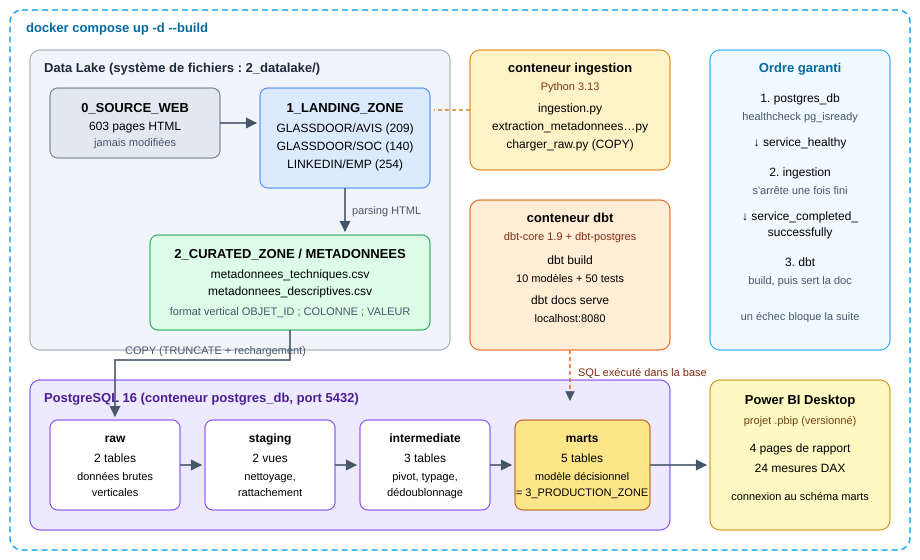
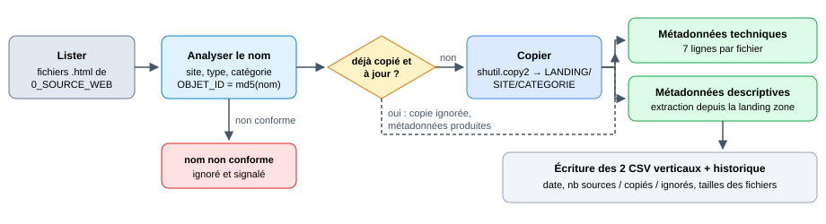
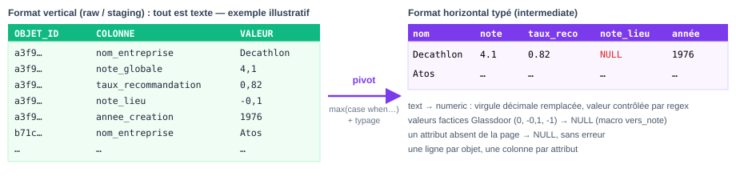
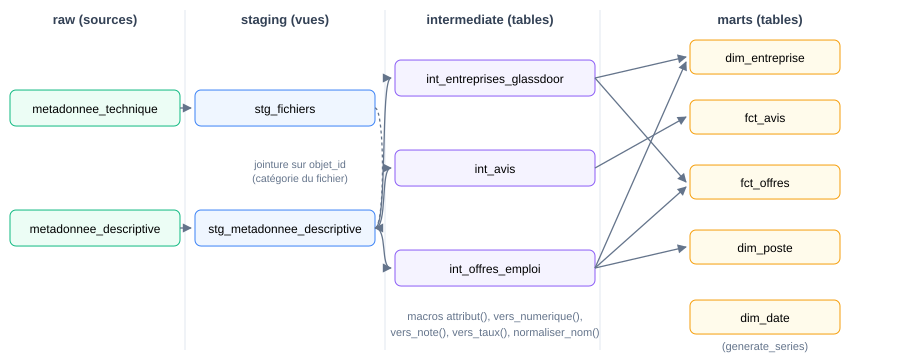
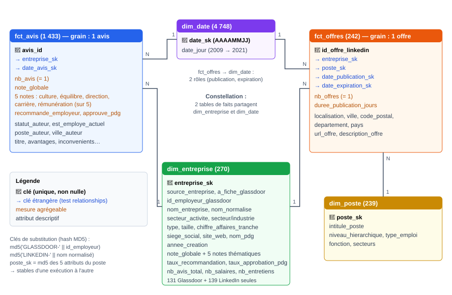
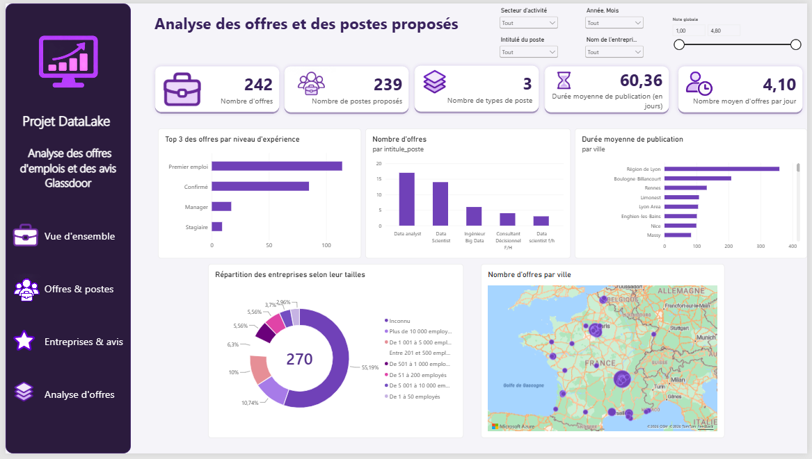
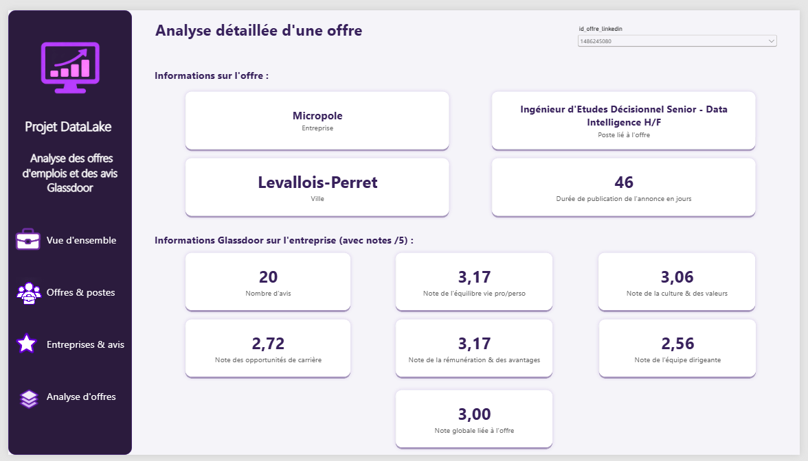
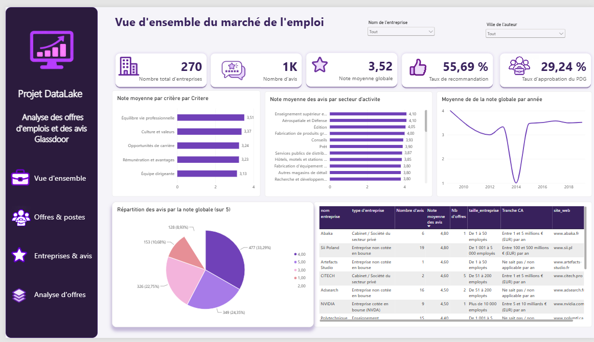
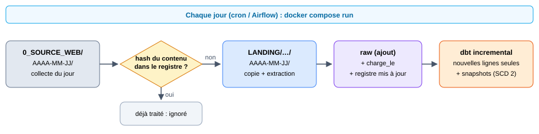

# 1. Objectif et résultat

À partir de **603 pages HTML** collectées sur LinkedIn (offres d'emploi) et Glassdoor (fiches entreprises et avis d'employés), nous avons construit un **Data Lakehouse complet** : collecte non destructive, ingestion dans un data lake organisé par zones, extraction des métadonnées, entrepôt de données décisionnel et tableaux de bord.

Le pipeline entier se reconstruit **en une seule commande**, depuis les fichiers HTML jusqu'au modèle décisionnel :

```
docker compose up -d --build
```

| Indicateur | Valeur |
|---|---|
| Fichiers HTML traités | 603 (254 offres, 140 fiches entreprise, 209 pages d'avis) |
| Métadonnées produites | 4 221 techniques, 39 630 descriptives |
| Modèle décisionnel | 2 tables de faits, 3 dimensions |
| Contrôles qualité automatiques | 50 tests dbt, exécutés à chaque lancement |
| Restitution | 4 pages Power BI, 24 mesures DAX |

**Accès une fois le pipeline lancé :** base PostgreSQL sur `localhost:5432` (identifiants dans `.env`, schéma `marts`), documentation des données sur **http://localhost:8080**, rapport Power BI dans `4_dataviz_pbi/`.

# 2. Architecture



Le pipeline suit les zones imposées par le sujet et les prolonge par une base de données :

| Zone | Emplacement | Contenu | Produit par |
|---|---|---|---|
| `0_SOURCE_WEB` | `2_datalake/` | HTML bruts, jamais modifiés | collecte |
| `1_LANDING_ZONE` | `2_datalake/` | copie à l'identique, rangée par site et type | `ingestion.py` |
| `2_CURATED_ZONE` | `2_datalake/` | métadonnées techniques et descriptives (CSV vertical) | `ingestion.py` + `extraction_…py` |
| `raw` | PostgreSQL | métadonnées chargées telles quelles | `charger_raw.py` |
| `staging` → `intermediate` | PostgreSQL | nettoyage, pivot, typage, dédoublonnage | dbt |
| `3_PRODUCTION_ZONE` = `marts` | PostgreSQL | modèle décisionnel interrogé par Power BI | dbt |

Les couches de la base reprennent le principe de l'**architecture médaillon** (bronze / argent / or) : `raw` conserve la donnée brute, `staging` et `intermediate` la fiabilisent, `marts` l'expose pour l'analyse.

## 2.1 Stack technique et choix

| Outil | Rôle | Pourquoi ce choix |
|---|---|---|
| **Python** (bibliothèque standard) | ingestion et extraction (phases 1 et 2) | lecture de fichiers et parsing HTML ; aucune dépendance externe pour ces deux phases |
| **PostgreSQL 16** | entrepôt de données | moteur SQL robuste et gratuit ; les transformations s'exécutent dans la base, au plus près des données |
| **dbt** | transformations (phase 3) | standard actuel de l'industrie : SQL versionné, **tests automatiques**, **documentation et lignage générés**, exécution rejouable |
| **Power BI** | reporting (phase 4) | outil BI le plus répandu en entreprise ; format `.pbip` (texte) versionnable dans Git |
| **Docker Compose** | orchestration | environnement identique sur chaque poste, ordre d'exécution garanti, une seule commande |
| **Git / GitHub** | versionnement et travail en équipe | branches par fonctionnalité, revue par pull request |

**ELT plutôt qu'ETL.** Le sujet propose par défaut un ETL en Python produisant des CSV. Nous avons préféré charger les métadonnées brutes en base puis transformer en SQL avec dbt (**ELT**) :

- chaque transformation est **testée** à chaque exécution (unicité, non-nullité, intégrité référentielle, valeurs autorisées) et une anomalie **bloque** le pipeline ;
- tout est **rejouable** : la base entière se reconstruit depuis les HTML, sans étape manuelle ;
- dbt génère la **documentation** et le **graphe de lignage** des données (gouvernance, section 7).

## 2.2 Conteneurisation

Chaque étape tourne dans son propre conteneur ; `docker-compose.yml` garantit l'ordre :

| Service | Image | Démarre quand | Fait |
|---|---|---|---|
| `postgres_db` | `postgres:16-alpine` | immédiatement | base de données, volume persistant, `healthcheck` (`pg_isready`) |
| `ingestion` | `python:3.13-slim` | la base répond (`service_healthy`) | phases 1 et 2, puis chargement du schéma `raw` ; s'arrête une fois fini |
| `dbt` | `python:3.12-slim` | l'ingestion a réussi (`service_completed_successfully`) | `dbt build` (modèles + tests), puis sert la documentation sur le port 8080 |

Dans le réseau Compose, les conteneurs se joignent par **nom de service** (`POSTGRES_HOST=postgres_db`) et non par `localhost`.

# 3. Organisation du projet

## 3.1 Arborescence

```
TD_gestion_donnees_massives/
├── 0_consignes/                 sujets et scripts d'exemple
├── 1_ingestion/                 phases 1 et 2 (Python) + Dockerfile
│   ├── config.py                chemins du projet
│   ├── ingestion.py             copie SOURCE → LANDING + métadonnées
│   ├── extraction_metadonnees_descriptives.py
│   └── charger_raw.py           chargement dans PostgreSQL (schéma raw)
├── 2_datalake/
│   ├── 0_SOURCE_WEB/            603 HTML (versionnés)
│   ├── 1_LANDING_ZONE/          GLASSDOOR/AVIS, GLASSDOOR/SOC, LINKEDIN/EMP
│   └── 2_CURATED_ZONE/METADONNEES/
├── 3_dbt_transformation/        phase 3 = 3_PRODUCTION_ZONE + Dockerfile
│   ├── macros/                  pivot et typage du format vertical
│   └── models/ staging/ intermediate/ marts/
├── 4_dataviz_pbi/               projet Power BI (.pbip)
├── rapport/
├── docker-compose.yml
└── .env                         identifiants de la base locale
```

Les dossiers sont **numérotés dans l'ordre du pipeline** et chacun a un seul rôle : le code est séparé des données. La landing zone et la curated zone ne sont pas versionnées : le pipeline les régénère à l'identique.

## 3.2 Méthode de travail et répartition

Le dépôt GitHub suit un flux à trois niveaux : `main` (version stable et livrée), `develop` (intégration), et une **branche par fonctionnalité** fusionnée par pull request (`reorganisation_dossier`, `modelisation_dbt`, `dataviz`).

| Membre | Rôle | Périmètre |
|---|---|---|
| **Nicolas MENY** | Ingestion | phases 1 et 2 : copie en landing zone, métadonnées techniques, extraction des métadonnées descriptives |
| **David TRUONG** | Transformation, modélisation, architecture | choix de la stack, organisation du dépôt, chargement `raw`, projet dbt, modèle décisionnel, conteneurisation, bon fonctionnement de bout en bout |
| **Ruth ABEBE NGUESSY** | Data visualisation | phase 4 : modèle sémantique et rapport Power BI |
| Toute l'équipe | Documentation | README et rapport |

# 4. Phases 1 et 2 : ingestion et extraction

## 4.1 Phase 1 : copie vers la landing zone



- **Lister et sélectionner** : `ingestion.py` parcourt `0_SOURCE_WEB` et ne retient que les fichiers `.html`. Le nom de chaque fichier est analysé (`extraire_informations_nom_fichier`) pour déterminer le site, le type d'information et la catégorie ; un nom non conforme est **ignoré et signalé**.
- **Copier** : `shutil.copy2` copie le fichier **à l'identique** (contenu et date de modification) vers `1_LANDING_ZONE/<SITE>/<CATEGORIE>/`. La source n'est jamais modifiée.
- **Ne pas recopier** : si le fichier existe déjà en landing zone avec une date de modification égale ou plus récente, la copie est ignorée. Relancer l'ingestion est donc sans effet sur les fichiers déjà traités.
- **Identifier** : chaque objet reçoit un identifiant stable `OBJET_ID` = hash MD5 du nom de fichier, identique d'une exécution à l'autre.
- **Tracer** : un fichier d'historique ajoute une ligne par exécution (date, nombre de fichiers sources, copiés, ignorés, taille des fichiers de métadonnées).

### Métadonnées techniques

Sept métadonnées techniques sont produites par fichier (603 × 7 = 4 221 lignes). Nous les avons rapprochées du standard **Dublin Core**, qui sert de référence pour décrire une ressource :

| Métadonnée produite | Exemple | Élément Dublin Core |
|---|---|---|
| `OBJET_ID` | `a3f9…` (MD5) | `dc:identifier` |
| `date_heure_de_recuperation` | `2026-11-13 09:12:04` | `dc:date` |
| `nom_du_fichier_source` | `13546-AVIS-SOC-GLASSDOOR-E12966_P1.html` | `dc:title` |
| `provenance_du_fichier_source` | `2_datalake/0_SOURCE_WEB/…` | `dc:source` |
| `nom_du_fichier_cible` / `localisation_du_fichier_cible` | `2_datalake/1_LANDING_ZONE/GLASSDOOR/AVIS/…` | `dc:relation` |
| `type_du_fichier_source` | `html` | `dc:format` |
| `categorie_du_fichier_source` | `AVIS_SOCIETE`, `INFO_SOCIETE`, `OFFRE_EMPLOI` | `dc:type` |

Enrichissements possibles avec Dublin Core : `dc:publisher` (LinkedIn ou Glassdoor), `dc:language` (fr), `dc:creator` (script et version ayant produit la copie), une empreinte du **contenu** du fichier pour prouver que la copie est identique à la source.

## 4.2 Phase 2 : extraction des métadonnées descriptives

`extraction_metadonnees_descriptives.py` lit chaque fichier **depuis la landing zone** et en extrait les informations métier. Le script d'exemple du sujet extrayait 4 champs pour les sociétés, 9 pour les avis et 4 pour les offres ; nous en extrayons beaucoup plus :

| Catégorie | Fichiers | Attributs extraits | Exemples d'attributs ajoutés |
|---|---|---|---|
| `OFFRE_EMPLOI` (LinkedIn) | 254 | 22 | dates de publication et d'expiration, niveau hiérarchique, type d'emploi, fonction, secteurs, code postal, pays |
| `INFO_SOCIETE` (Glassdoor) | 140 | 45 | secteur, industrie, taille, chiffre d'affaires, année de création, PDG, notes globales, taux de recommandation, statistiques d'entretien |
| `AVIS_SOCIETE` (Glassdoor) | 209 | 23 par page + 18 par avis | 6 notes thématiques par avis, recommandation, avis sur le PDG, statut de l'auteur, conseils à la direction |

**Fonctions d'extraction.** Plutôt que de lire uniquement le texte visible, les fonctions exploitent les **données structurées embarquées** dans les pages, plus fiables que la mise en page :

| Fonction | Rôle |
|---|---|
| `_extraire_offre_emploi` | offre LinkedIn : bloc JSON-LD `schema.org/JobPosting` + critères de l'offre |
| `_extraire_info_societe` | fiche Glassdoor : état JSON de la page + variables `gdGlobals` |
| `_extraire_avis_societe` | page d'avis : notes de l'entreprise, puis chaque avis avec son préfixe `avis_N_` |
| `_objet_json` | extrait un objet JSON du HTML en comptant les accolades (tolère les `}` dans les chaînes) |
| `_gdglobals_employeur` | lit le bloc JavaScript `employer` de Glassdoor |
| `_texte`, `_decimal`, `_date_iso` | HTML → texte propre, nombre avec virgule décimale, date ISO |
| `_ajouter` | n'ajoute un couple (attribut, valeur) que s'il est non vide et pas déjà présent : extraction **idempotente** |

Les deux fichiers de métadonnées ont **la même structure verticale** `OBJET_ID ; COLONNE ; VALEUR`, en UTF-8, séparateur `;`.

## 4.3 Format vertical ou horizontal ?



Le sujet impose un stockage **vertical** (modèle entité-attribut-valeur, EAV). Nous l'avons conservé dans le data lake et jusqu'à la couche `staging`, puis **pivoté en format horizontal** dans la couche `intermediate`.

| | Format vertical (EAV) | Format horizontal |
|---|---|---|
| **Avantages** | une seule structure pour des sources hétérogènes (offres, sociétés, avis) ; ajouter un attribut ne change pas le schéma ; pas de colonnes vides quand un attribut manque ; chargement simple | lisible, une ligne par objet ; chaque colonne a son type (nombre, date) ; requêtes, agrégations et outils BI directs ; contrôles qualité par colonne |
| **Inconvénients** | tout est stocké en texte ; il faut pivoter avant d'analyser ; requêtes plus lourdes ; volume plus grand (l'identifiant et le nom d'attribut sont répétés) | schéma figé : un nouvel attribut impose de modifier la table ; colonnes souvent vides si les sources diffèrent |
| **Usage dans le projet** | data lake, `raw`, `staging` : **stockage** | `intermediate`, `marts` : **analyse** |

Le pivot concilie les deux : le data lake reste ouvert à de nouvelles sources ou de nouveaux attributs, et l'entrepôt offre des tables typées à l'analyse.

# 5. Phase 3 : entrepôt de données avec dbt

## 5.1 Chargement de la donnée brute

`charger_raw.py` charge les deux CSV de la curated zone dans le schéma `raw` avec un `COPY` PostgreSQL (chargement en masse), **sans aucune transformation**. Les tables sont vidées (`TRUNCATE`) puis rechargées à chaque exécution plutôt que supprimées, car les vues dbt en dépendent : le pipeline peut être relancé autant de fois que nécessaire.

## 5.2 Transformations



| Couche | Modèles | Rôle | Matérialisation |
|---|---|---|---|
| `staging` | `stg_fichiers`, `stg_metadonnee_descriptive` | rattache chaque valeur à son fichier (catégorie, préfixe), extrait l'identifiant des avis, décode les entités HTML. Reste au format vertical. | vues |
| `intermediate` | `int_entreprises_glassdoor`, `int_avis`, `int_offres_emploi` | **pivote** (une colonne par attribut), **type** les valeurs, **dédoublonne** : une table par type de document | tables |
| `marts` | `dim_entreprise`, `dim_date`, `dim_poste`, `fct_avis`, `fct_offres` | modèle décisionnel interrogé par Power BI | tables |

**Le typage se fait au pivot, pas en staging** : la colonne `VALEUR` mélange textes, notes et dates ; elle ne peut être typée qu'une fois chaque attribut dans sa propre colonne. Des macros dbt réutilisables (`macros/pivot.sql`) factorisent ce travail :

| Macro | Rôle |
|---|---|
| `attribut('nom')` | extrait un attribut du format vertical (`max(case when colonne = … then valeur end)`) |
| `vers_numerique` | texte → nombre : virgule décimale, contrôle par expression régulière (une valeur invalide donne `NULL` au lieu d'une erreur) |
| `vers_note` | note sur 5 : les valeurs factices de Glassdoor (`0`, `-0,1`, `-1`) signifient « non renseigné » et deviennent `NULL` |
| `vers_taux` | taux entre 0 et 1 |
| `normaliser_nom` | nom d'entreprise en minuscules, sans ponctuation, pour rapprocher LinkedIn et Glassdoor |

## 5.3 Qualité des données

Les tests dbt, posés dès la couche `intermediate`, ont fait remonter les problèmes des sources. Chacun est traité dans le pipeline :

| Problème constaté | Ampleur | Traitement |
|---|---|---|
| Avis présents sur plusieurs pages | 1 537 lus → **1 433** uniques (104 doublons) | dédoublonnage sur l'identifiant de l'avis |
| Offres récupérées plusieurs fois | 254 → **242** (12 doublons) | dédoublonnage sur l'identifiant LinkedIn |
| Entreprises récupérées sous deux noms de fichier | 140 fiches → **131** entreprises (9 doublons) | une seule fiche conservée par identifiant Glassdoor |
| Valeurs factices « pas de note » (`0`, `-0,1`, `-1`) | toutes les notes | converties en `NULL` |
| Virgules décimales, entités HTML (`&amp;`) | nombres et textes | converties et décodées |
| Code postal placé dans le champ ville (LinkedIn) | localisation des offres | séparé en ville, code postal, département |
| Offres sans fiche Glassdoor correspondante | **72 offres sur 242** rattachées | entreprises LinkedIn ajoutées à `dim_entreprise` pour ne perdre aucune offre |
| Collecte partielle des avis | 2 pages, soit au plus **20 avis** par entreprise | limite signalée : les moyennes d'avis sont indicatives |

**50 tests** sont exécutés à chaque lancement : unicité et non-nullité des clés, intégrité référentielle entre faits et dimensions (`relationships`), valeurs autorisées. Le dernier lancement : **60 nœuds (10 modèles + 50 tests), 0 erreur, 0 avertissement**.

# 6. Modèle décisionnel



Le modèle est une **constellation** : deux tables de faits, l'une sur les avis, l'autre sur les offres, partagent les dimensions `dim_entreprise` et `dim_date`. On peut ainsi croiser dans une même analyse l'activité de recrutement d'une entreprise et la satisfaction de ses employés.

- **Grain** : une ligne de `fct_avis` = un avis ; une ligne de `fct_offres` = une offre. Une offre est un **fait sans mesure numérique** : on la compte (`nb_offres = 1`).
- **Rattachement LinkedIn ↔ Glassdoor** : il n'existe pas d'identifiant commun ; une offre est rattachée à une fiche Glassdoor par le **nom d'entreprise normalisé**. Si plusieurs fiches correspondent (Atos, La Redoute), on retient celle qui a le plus d'avis.
- **Clés de substitution** : hash MD5 préfixé par la source. Elles sont identiques d'une exécution à l'autre et ne peuvent pas entrer en collision entre Glassdoor et LinkedIn.
- **Dimension de rôle** : `dim_date` est reliée deux fois à `fct_offres` (date de publication, date d'expiration).

## 6.1 Dictionnaire de données

**`fct_avis`** — un avis d'employé Glassdoor (1 433 lignes)

| Colonne | Type | Description |
|---|---|---|
| `avis_id` | bigint | identifiant Glassdoor de l'avis (clé) |
| `entreprise_sk` | text | → `dim_entreprise` |
| `date_avis_sk` | integer | → `dim_date` (AAAAMMJJ) |
| `note_globale` | numeric | note globale sur 5 |
| `note_culture_valeurs`, `note_equilibre_vie_pro`, `note_equipe_dirigeante`, `note_opportunites_carriere`, `note_remuneration_avantages` | numeric | notes thématiques sur 5 (`NULL` si non renseignée) |
| `recommande_employeur`, `approuve_pdg` | boolean | l'auteur recommande l'entreprise / approuve le PDG |
| `nb_avis` | integer | toujours 1, pour compter |
| `perspective_entreprise` | text | perspective de l'auteur sur l'entreprise |
| `statut_auteur`, `est_employe_actuel` | text, boolean | statut de l'auteur (employé actuel ou ancien) |
| `poste_auteur`, `ville_auteur` | text | poste et ville de l'auteur |
| `titre`, `avantages`, `inconvenients`, `conseils_direction` | text | contenu rédigé de l'avis |

**`fct_offres`** — une offre d'emploi LinkedIn (242 lignes)

| Colonne | Type | Description |
|---|---|---|
| `id_offre_linkedin` | bigint | identifiant LinkedIn de l'offre (clé) |
| `entreprise_sk` | text | → `dim_entreprise` |
| `poste_sk` | text | → `dim_poste` |
| `date_publication_sk`, `date_expiration_sk` | integer | → `dim_date` |
| `nb_offres` | integer | toujours 1, pour compter |
| `duree_publication_jours` | integer | nombre de jours entre publication et expiration |
| `localisation`, `ville`, `code_postal`, `departement`, `pays` | text | lieu du poste |
| `url_offre`, `description_offre` | text | lien et texte de l'offre |

**`dim_entreprise`** — une entreprise (270 lignes : 131 avec fiche Glassdoor, 139 vues seulement sur LinkedIn)

| Colonne | Type | Description |
|---|---|---|
| `entreprise_sk` | text | clé de substitution |
| `source_entreprise`, `a_fiche_glassdoor` | text, boolean | `GLASSDOOR` ou `LINKEDIN` |
| `id_employeur_glassdoor` | bigint | identifiant Glassdoor (vide pour LinkedIn seul) |
| `nom_entreprise`, `nom_normalise` | text | nom affiché, nom servant au rapprochement |
| `secteur_activite`, `secteur_glassdoor`, `industrie_glassdoor` | text | secteur |
| `type_entreprise`, `taille_entreprise`, `taille_entreprise_code`, `chiffre_affaires_tranche`, `statut_entreprise_code` | text | profil de l'entreprise |
| `siege_social`, `site_web`, `nom_pdg`, `annee_creation` | text, integer | identité |
| `note_globale` + 5 notes thématiques | numeric | moyennes Glassdoor de l'entreprise, sur 5 |
| `taux_recommandation`, `taux_approbation_pdg`, `taux_perspective_positive` | numeric | taux entre 0 et 1 |
| `nb_avis_total`, `nb_salaires`, `nb_entretiens`, `nb_offres_glassdoor` | integer | volumes affichés par Glassdoor |
| `entretien_difficulte_moyenne` | numeric | difficulté moyenne des entretiens |

**`dim_poste`** — un profil de poste (239 lignes) : `poste_sk` (clé), `intitule_poste`, `niveau_hierarchique`, `type_emploi`, `fonction`, `secteurs`.

**`dim_date`** — un jour du 01/01/2009 au 31/12/2021 (4 748 lignes) : `date_sk` (AAAAMMJJ), `date_jour`. Power BI en dérive l'année, le mois et le jour.

# 7. Gouvernance des données

dbt génère une **documentation consultable** à chaque lancement, servie sur **http://localhost:8080** :

- description de chaque source, modèle et colonne ;
- **graphe de lignage** : d'où vient chaque table, de la source brute jusqu'à la couche `marts` ;
- liste des tests associés à chaque colonne ;
- code SQL de chaque modèle, brut et compilé.

S'y ajoutent la **traçabilité** propre au data lake (métadonnées techniques reliant chaque donnée à son fichier source par `OBJET_ID`, historique des exécutions) et le **versionnement** de tout le code dans Git.

# 8. Phase 4 : restitution avec Power BI

Le rapport Power BI se connecte au schéma `marts`. Le modèle sémantique reprend les relations du modèle décisionnel et ajoute **24 mesures DAX** (nombre d'offres, durée moyenne de publication, note moyenne, taux de recommandation, taux d'approbation du PDG, notes par critère…).

| Page | Question à laquelle elle répond | Visuels principaux |
|---|---|---|
| **Vue d'ensemble du marché de l'emploi** | combien d'offres et d'entreprises, publiées quand, où ? | indicateurs clés, évolution des publications, répartition par type d'emploi et par ville, part d'employés actuels parmi les auteurs d'avis |
| **Offres & postes** | quels postes, à quel niveau, dans quelles entreprises, où ? | carte des offres par ville, répartition par intitulé et niveau hiérarchique, par taille et secteur d'entreprise, filtres |
| **Analyse détaillée d'une offre** | que vaut une offre précise ? | fiche de l'offre (poste, durée de publication) et notes par critère de l'entreprise qui recrute |
| **Entreprises & avis** | que pensent les employés de leur entreprise ? | note moyenne, taux de recommandation et d'approbation du PDG, notes par critère, évolution des avis, tableau par entreprise |








# 9. Historiser chaque jour et ne traiter que les nouvelles données

Le sujet pose la question d'un traitement **historisé quotidiennement**, qui ne traiterait chaque jour que les nouveaux fichiers. Notre pipeline en contient déjà les premiers éléments (copie ignorée si le fichier existe déjà, identifiant stable, historique des exécutions) ; la solution complète serait :



1. **Partitionner par date de collecte** : `0_SOURCE_WEB/AAAA-MM-JJ/` et `1_LANDING_ZONE/<SITE>/<CATEGORIE>/AAAA-MM-JJ/`. Rien n'est écrasé : chaque jour reste consultable.
2. **Tenir un registre des fichiers traités** (table `raw.fichiers_traites`) avec l'empreinte du **contenu** (hash), la date de traitement et le statut. Chaque jour, seuls les fichiers dont l'empreinte est absente du registre sont copiés et extraits. Un fichier modifié a une nouvelle empreinte, il est donc retraité ; le hash prouve aussi que la copie est identique à la source.
3. **Charger en ajout** dans `raw` (et non plus `TRUNCATE`), chaque ligne portant sa date de chargement (`charge_le`).
4. **Transformer en incrémental avec dbt** : modèles `materialized='incremental'` qui ne traitent que les lignes chargées depuis la dernière exécution (`is_incremental()`), et **snapshots** dbt pour historiser les changements d'une entreprise (note, taille) au fil du temps (dimension à évolution lente de type 2).
5. **Planifier** l'exécution quotidienne (cron, ou un orchestrateur comme Airflow ou Dagster) qui lance la même commande `docker compose`.

# 10. Limites et pistes d'amélioration

| Limite | Piste |
|---|---|
| Rapprochement LinkedIn ↔ Glassdoor par nom : 72 offres sur 242 seulement | rapprochement approché (distance entre noms), ou identifiant externe (SIREN) |
| Au plus 20 avis par entreprise | collecter toutes les pages d'avis |
| La copie n'a pas de gestion d'erreur explicite : un fichier illisible arrête l'ingestion | `try/except` par fichier, journal des erreurs, contrôle d'intégrité par hash après copie |
| Rechargement complet à chaque exécution | traitement incrémental (section 9) |
| `.env` versionné | acceptable pour une base locale de TD ; en production, gestionnaire de secrets |

# Annexe A : livrables

| Livrable demandé | Où le trouver |
|---|---|
| Code source | dépôt Git : `1_ingestion/` (Python), `3_dbt_transformation/` (SQL dbt), `docker-compose.yml` |
| Bibliothèques Python | voir tableau ci-dessous |
| Fichiers de données | `2_datalake/0_SOURCE_WEB/` (603 HTML) ; la landing zone et les CSV de la curated zone sont régénérés par le pipeline |
| Scripts de création des tables et données | **générés par dbt** : chaque modèle SQL de `3_dbt_transformation/models/` est transformé par dbt en `CREATE TABLE … AS SELECT` / `CREATE VIEW`, exécuté dans la base à chaque `dbt build`. Le SQL compilé de chaque table est visible dans la documentation (localhost:8080). Les tables `raw` sont créées par `charger_raw.py`. |
| Fichiers de dataviz | `4_dataviz_pbi/` : projet Power BI `.pbip` (rapport + modèle sémantique) |

| Bibliothèque | Version | Utilisation |
|---|---|---|
| `os`, `shutil`, `csv`, `hashlib`, `datetime` | standard | parcours, copie, écriture des CSV, identifiants MD5, horodatage |
| `re`, `html`, `json`, `logging` | standard | extraction des métadonnées descriptives |
| `psycopg[binary]` | 3.2.3 | connexion PostgreSQL et `COPY` |
| `dbt-core`, `dbt-postgres` | 1.9.0 | transformations, tests, documentation |

# Annexe B : lancer le projet

1. Lancer **Docker Desktop**, puis à la racine du dépôt : `docker compose up -d --build`.
2. Attendre la fin de `dbt` (`docker compose logs -f dbt` affiche `Done. PASS=60`) ; documentation sur **http://localhost:8080**.
3. Ouvrir `4_dataviz_pbi/Gestion de données massives.pbip` dans Power BI Desktop et actualiser (`localhost:5432`).
